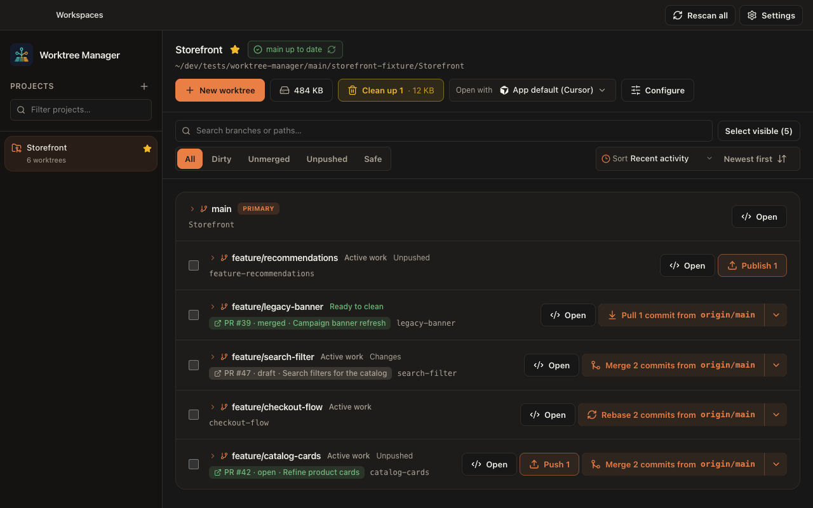
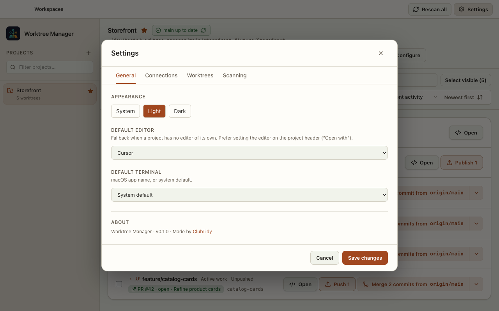
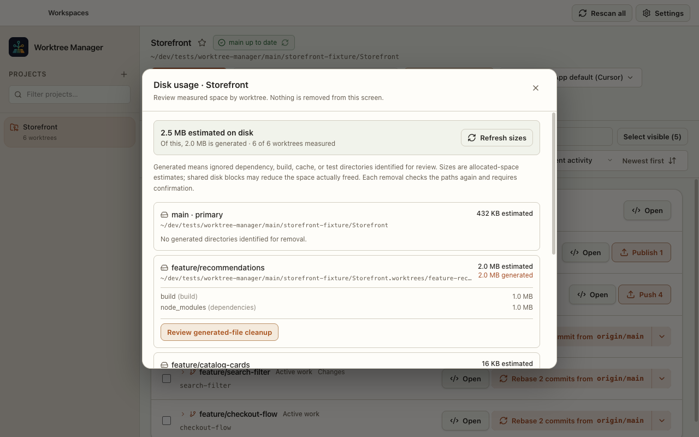
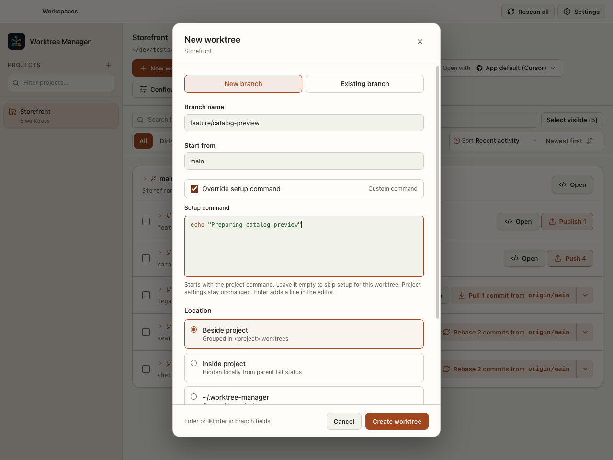
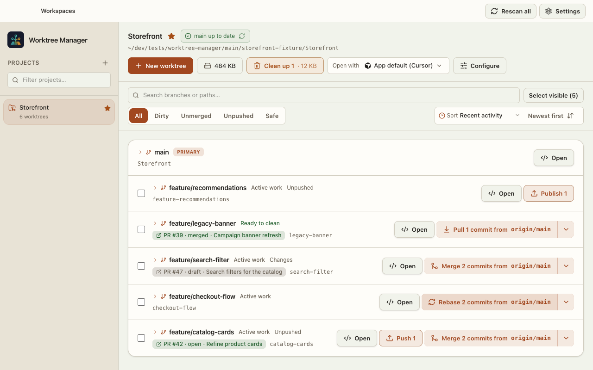

<div align="center">


# Worktree Manager

**A desktop app to create, manage, and clean up Git worktrees across projects.**

By [ClubTidy](https://clubtidy.fr).

See branches, pull requests, local changes, and cleanup candidates in one place. Create
worktrees with a destination preview, run project setup, and reclaim regenerable disk
space when work is done.

[](https://github.com/Brechard/worktree-manager/actions/workflows/ci.yml)
[](LICENSE)
[](#install)

[**Download the latest release**](https://github.com/Brechard/worktree-manager/releases/latest)

[**Install**](#install) ·
[Features](#features) ·
[Why](#why-this-exists) ·
[Build from source](#build-from-source)



</div>

---

## Why this exists

Git worktrees are the best way to work on several branches at once — no stashing, no
`git checkout` thrash, each branch a real folder your editor and dev server can hold open.
They're also the easiest thing in git to lose track of.

After a few weeks you have thirty folders across a dozen repos and no idea which ones
still matter. Was that branch merged? Did I push it? Is there a PR? Is anything
uncommitted in there? Answering that for one worktree is `cd` plus four git commands.
Answering it for thirty is an afternoon — so nobody does, the folders pile up, and each
one is carrying its own copy of `node_modules`.

Worktree Manager answers all of it on one screen, for every repo at once, and then lets
you act on the answer.

We built it at [ClubTidy](https://clubtidy.fr) because our own worktree sprawl got out of
hand — a dozen repos, several AI coding agents each working in their own worktree, and
hundreds of gigabytes of dependencies. It's MIT-licensed and standalone; nothing about it
is [ClubTidy](https://clubtidy.fr)-specific.

> Inspired by [t3code](https://github.com/pingdotgg/t3code/), rebuilt around
> multi-repo scale, pull-request awareness, and disk reclaim.

## Features

### Know what's safe to delete

Worktree Manager checks local changes, unpushed commits, merge state, and pull-request
information before marking a worktree ready for cleanup. When git or a configured
provider cannot be checked, cleanup eligibility stays uncertain; an authentication
problem shows a repair banner while any last-known PR link stays visible. After you
confirm removal, the row clears with a brief cleaning wipe while the operation runs;
if cleanup or deletion fails, it returns with a Retry action.

Select individual rows or **Select visible** after filtering a project, then choose
**Remove selected** to review each worktree's changed files and local commits. Manual
removal moves folders to Trash and keeps their branches; changing the filter clears
selections that are no longer visible.

### See it across every repo

Point it at the directories you keep code in and it discovers every git repository and
every linked worktree underneath. Filter to dirty / unmerged / unpushed / safe, sort by
recent activity, search branches and paths, star the projects you live in.

<div align="center">

</div>

### Pull requests inline

Connect GitHub or Azure DevOps and each branch shows its PR number, title, and state —
including draft, open, and merged — right on the row. If authentication expires, a repair
prompt links back to connection settings while the last known PR stays visible. In
**Settings → Connections**, **Detect** can fill a token from an existing `gh auth` or
`az` login or a supported environment variable such as `GH_TOKEN` or
`AZURE_DEVOPS_PAT`. Save the detected token to use it for PR checks. Saved tokens are
encrypted at rest via Electron's `safeStorage`.
If the operating system key store is unavailable, saving a token fails with an
error rather than writing it in plain text. Existing plain-text credentials are
migrated when settings or projects are loaded; rotate any token that may have
been copied into an older backup.

### Reclaim disk

The reason ten branches cost ten copies of your dependency tree. Worktree Manager
measures the regenerable directories (`node_modules`, build output, caches) across your
worktrees and lets you delete them from one place. It's a deliberate allow-list of
directories a tool can rebuild — never "everything git ignores", which would take your
`.env` files with it.

Open **Disk usage** in a project header for a per-worktree breakdown. The total and
generated amounts are allocated-space estimates; generated usage is included in the total
and covers ignored dependency, build, cache, and test directories identified for review.
The dialog shows how many worktrees were measured; missing or failed sizes are marked, and
**Refresh sizes** retries them. Review generated files per worktree; cleanup requires
confirmation. Shared disk blocks can mean the space actually freed is lower than the
estimate.

<div align="center">

</div>

### Real git actions, not just a list

Rows surface **Publish** for an unpublished branch, **Push** for local commits, and
**Sync** or **Rebase** when a branch needs updates. The action menu also offers merge,
merge --no-ff, squash merge, checkout, and pruning stale worktrees. Per-project custom
buttons can run commands such as `docker compose up`, `bun install`, or your test suite
against a chosen worktree in a terminal or in the background.

**New worktree** creates a branch or checks out an existing one from the project header.
Choose a location beside the project, inside it, under `~/.worktree-manager`, or in a
custom parent directory; the destination and source commit are previewed before creation.
Set the default location in the **Settings** popup, or override it in **Project settings**.
A project setup command can run afterward with `WORKTREE_PATH`, `WORKTREE_BRANCH`,
`REPO_PATH`, and `REPO_NAME` in its environment. An interrupted or failed setup stays
visible on the row with **Retry setup**.
The creation dialog can override that command for one worktree. Checking **Override setup
command** fills the editor with the project command; edit it, or clear it to skip setup.
The project setting stays unchanged. **Retry setup** retains a custom override; without
one, retry uses the current project command.

In the creation dialog, **Enter** or **Shift+Enter** from a single-line field submits the
current valid preview; **⌘Enter** on macOS or **Ctrl+Enter** elsewhere also submits.

<div align="center">

</div>

### Opens where you work

Detects your installed editors and opens a worktree in the one you pick — per project, so
the Rider repo opens in Rider and the TypeScript one opens in Cursor. Also opens a
terminal or a file manager at the worktree path.

<div align="center">

</div>

### Keyboard shortcuts

| Action                                | macOS                         | Other platforms                   |
| ------------------------------------- | ----------------------------- | --------------------------------- |
| New worktree for the selected project | ⌘N                            | Ctrl+N                            |
| Focus worktree search                 | ⌘F                            | Ctrl+F                            |
| Open Settings                         | ⌘,                            | Ctrl+,                            |
| Create from a single-line field       | Enter, Shift+Enter, or ⌘Enter | Enter, Shift+Enter, or Ctrl+Enter |
| Close a dialog                        | Esc                           | Esc                               |

Dashboard shortcuts also work while a dashboard field is focused. They are paused while a
dialog is open, and the same shortcuts are listed in Settings.

## Install

Download the latest release for your system from the
[GitHub Releases page](https://github.com/Brechard/worktree-manager/releases/latest).
Git must be installed and available on your `PATH` to manage worktrees.

| System                | Asset to choose                              | Install                                                     |
| --------------------- | -------------------------------------------- | ----------------------------------------------------------- |
| macOS (Apple silicon) | `Worktree-Manager-<version>-macos-arm64.dmg` | Open the DMG and drag **Worktree Manager** to Applications. |
| macOS (Intel)         | `Worktree-Manager-<version>-macos-x64.dmg`   | Open the DMG and drag **Worktree Manager** to Applications. |
| Windows (x64)         | Windows installer (`.exe`)                   | Run the installer and follow its prompts.                   |
| Linux (x64)           | Linux AppImage                               | Make the AppImage executable, then run it.                  |

The macOS apps are signed with ClubTidy's **Developer ID** and notarized by Apple.
The Windows installer is currently unsigned, so SmartScreen may show an
**Unknown publisher** warning. Each platform also has a ZIP download, and the release
includes `SHA256SUMS` for verifying downloads. No Bun or Node installation is needed to
run a downloaded app.

### Build and install locally

Requires [Bun](https://bun.sh) 1.4.4+, Node 22+ and git (Git Bash on Windows):

```bash
git clone https://github.com/Brechard/worktree-manager.git
cd worktree-manager && ./scripts/install-local.sh
```

The script detects your OS and CPU architecture, installs dependencies, builds the
matching installer, and on macOS moves the app into `/Applications` and launches it.
Pass `--no-install` if you only want the artifact.

Artifacts land in `apps/desktop/release/`.

### Build from source

Requires [Bun](https://bun.sh) 1.4.4+ and Node 22+.

```bash
git clone https://github.com/Brechard/worktree-manager.git
```

```bash
cd worktree-manager && bun install && bun dev
```

To produce an installer for your own platform manually:

```bash
bun run dist
```

or, for a specific target:

```bash
cd apps/desktop && npx electron-builder --mac # or --win, --linux
```

## How it works

Worktree Manager stores projects, worktrees, settings, and cached status locally in its
Electron user-data directory. It has no hosted account, app telemetry, or application
server. Git operations such as fetch and push contact your configured remotes; provider
connections request pull-request details from GitHub or Azure DevOps. Custom commands
and project setup scripts run locally and may access the network according to what you
configure.

Settings live in the Electron user-data directory as JSON. Provider tokens use
versioned encrypted records through Electron's `safeStorage` (Keychain on macOS,
DPAPI on Windows, libsecret on Linux). The app decrypts them only in memory for
provider requests and settings editing.

## Tech stack

Electron · React 19 · TypeScript · Tailwind CSS 4 · Zustand · TanStack Query · Zod ·
Bun workspaces · Turbo

Git logic lives in `packages/shared` and runs only in the main process; the renderer
reaches it over typed IPC. `packages/contracts` holds the Zod schemas both sides share.
See [CLAUDE.md](CLAUDE.md) for the architecture notes and development gotchas.

## Contributing

Issues and pull requests are welcome — see [CONTRIBUTING.md](CONTRIBUTING.md).
If you use it and it saves you a folder, a ⭐ helps other people find it.

## License

[MIT](LICENSE) © [ClubTidy](https://clubtidy.fr)
